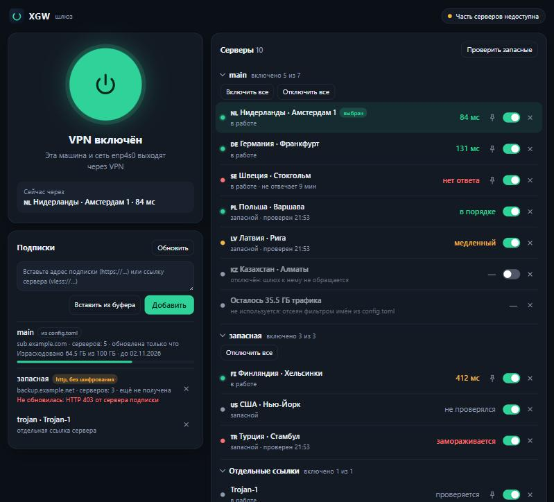

# XGW — шлюз Ubuntu 26.04 на Xray-core с автопереключением VPN-серверов

XGW превращает машину с Ubuntu 26.04 в шлюз для всей Wi-Fi-сети: nftables
(TPROXY) перехватывает трафик устройств и самой машины и отдаёт его Xray-core,
а Xray сам выбирает живой сервер.

Управлять им можно из [панели в браузере](#панель-управления) — кнопка включения
VPN, подписки, список серверов — или командами `xgw …` в терминале: и то и
другое делает одно и то же.

## Зачем

Провайдер (ТСПУ) не рвёт соединение с VPN-сервером, а «замораживает» его: после
15–20 КБ данных в одной TCP-сессии пакеты перестают приходить. ICMP-пинг,
TCP-рукопожатие и HTTP HEAD проходят, поэтому клиенты считают сервер живым и не
переключаются. Счётчик байтов работает на каждое соединение отдельно — находит
«заморозку» только скачивание тела больше порога.

Поэтому проверка в Xray — `burstObservatory` с `httpMethod: "GET"` (ядро
скачивает тело целиком; поле и дочитывание тела появились в v25.7.23). Проба
падает по таймауту на «замороженном» сервере, и балансировщик исключает узел —
новые соединения уходят через рабочий не позже чем за 1–2 цикла
`interval × sampling`. У sing-box (urltest) и mihomo (url-test) проверка —
зашитый в код HEAD-запрос, они «заморозку» не видят.

```
Устройства Wi-Fi ──► Wi-Fi-роутер (точка доступа) ──► LAN Ubuntu-шлюза
                                                          │
   Приложения Ubuntu ──► nftables output ─┐              │
                                           ▼              ▼
                              nftables prerouting (TPROXY, метка 1)
                                           │
                                     Xray (tunnel-in)
                              DNS→dns-out, RU→direct,
                        прочее → балансировщик auto (leastPing)
                     GET-пробы burstObservatory ──► VPN-серверы
                                           │
                              сокеты Xray и прямые запросы XGW
                              уходят в WAN с меткой 2 (мимо перехвата)
```

Переключением управляет только Xray. XGW работает рядом: тянет подписки,
генерирует конфиг, применяет изменения на лету через API (`xray api ado/rmo/
adrules` — Xray не умеет перечитывать конфиг), следит за состоянием (watchdog,
скан запасных, утечки), уведомляет и показывает статус.

## Статус реализации

| Этап | Содержание | Статус |
|---|---|---|
| 1 | Конфиг, подписки (кэш, квота), парсеры ссылок, генератор, загрузка Xray, `xgw generate`, `xray run -test` | ✅ готов (юнит-тесты; `xray run -test` — при наличии бинарника) |
| 2 | API (ado/rmo/adi/rmi/adrules/bi), diff, применение без разрыва, метрики, демон с watchdog, скан запасных, замена участников, команды `apply`/`status`/`servers`/`probe`/`pin`/`unpin`/`run`, стенд | ✅ готов: проверки стенда пройдены на живом Xray 26.3.27 в обоих режимах — loopback (Windows и Linux) и netns (Ubuntu 26.04.1 в WSL2, root) |
| 3 | nftables/TPROXY, маршрутизация по меткам, dnsmasq, перехват DNS, fail-closed и fail-open, обход VPN, команды `enable`/`disable`/`net`, проверки стенда из LAN | ✅ готов: все проверки из LAN пройдены на стенде в netns (Ubuntu 26.04.1 в WSL2, nftables 1.1.6, dnsmasq 2.92, Xray 26.3.27) |
| 4 | `install`/`uninstall`, службы systemd, профиль NetworkManager, сон, ufw, `diag`, `update-xray`, `logs`, уведомления, страница статуса | код готов и проверен на «одноразовой машине» — загруженная Ubuntu 26.04.1 в контейнере (systemd 259, NetworkManager 1.54.3, ufw 0.36.2, dnsmasq 2.92). На настоящей машине (Ubuntu 24.04.5, две карты, настоящие подписки) проверены установка, перехват, DNS, `disable`/`enable`, порядок загрузки и удаление — `docs/TEST-REPORT-2026-10-14.md`; найденные там дефекты исправлены (ASSUMPTIONS, пп. 150–163), но **повторно на той машине исправления не проверялись**, как и устройство в Wi-Fi через настоящий роутер |
| 5 | IPv6, TUN-inbound, Telegram-бот, правила per-device | опционально; сделаны **правила для устройств** (мимо VPN кнопкой в панели), **бот Telegram с командами** и **проксирование IPv6 самой машины** (`network.ipv6 = "proxy"`; проверено на стенде в netns и на «одноразовой машине», на настоящей сети с IPv6 — нет) и **режим TUN** для трафика самой машины (`capture.method = "tun"`; проверено на Xray 26.3.27 на стенде и на «машине», на Xray новее — нет, см. ASSUMPTIONS, пп. 134–139) |
| сверх ТЗ | Панель управления в браузере: включение VPN, подписки, серверы каждой подписки с отключением и удалением, закрепление; установка без правки файлов | код готов; сервер панели и её действия проверены юнит-тестами и на «одноразовой машине», страница — в браузере на выдуманных данных; **на настоящей машине и в Firefox Ubuntu не открывалась** |

Что проверено на стенде (раздел 9 ТЗ, проверки этапа 2):

- `freeze_after=16384` на выбранном узле → `xray api bi` показывает другой узел
  за 6–16 с при `interval = 10s`, `sampling = 1` (предел по ТЗ — 2 цикла, 25 с),
  в netns — за 7–16 с; `xgw probe` такого узла отвечает `FROZEN`;
- контроль: с `httpMethod: HEAD` тот же «замороженный» узел остаётся выбранным;
- добавление и удаление сервера в подписке применяются через API, загрузка
  длиной 12 с через неизменившийся узел не прерывается, Xray не перезапускается;
- «замороженного» участника демон меняет на проверенный запасной; закрепление
  `xgw pin` снимается по истечении срока.

Проверки из LAN (этап 3; шлюз с двумя картами, «интернет» и устройство — три
пространства имён):

- устройство в LAN выходит через VPN-сервер; DNS-запрос к любому серверу —
  `8.8.8.8` по UDP и TCP, адрес шлюза — обслуживает Xray; сайт по имени открывается;
- трафик самой машины тоже идёт через Xray, а сокеты с меткой `mark_bypass` — напрямую;
- остановленный Xray → ни устройство, ни сама машина никуда не выходят
  (fail-closed); после `xgw disable` интернет работает напрямую меньше чем через
  5 с, включая DNS; `xgw enable` возвращает перехват;
- устройство из `bypass_hosts` ходит мимо VPN и при остановленном Xray;
- при «заморозке» выбранного сервера новые соединения устройства идут через
  другой сервер не позже чем через 25 с;
- `fail_mode = "open"`: Xray недоступен дольше минуты — перехват снимается,
  Xray вернулся — возвращается;
- демон возвращает правила, если их таблицу удалили; dnsmasq выдаёт адрес из
  диапазона и статическую аренду, шлюз и DNS-сервер в аренде — адрес шлюза;
- контейнер Docker за мостом `docker0` (стенд повторяет сеть Docker, br_netfilter
  включён) выходит через VPN, его DNS отвечает Xray, опубликованный порт работает;
  Docker, поставленный уже после XGW, демон подхватывает сам (`test_stand_docker.py`).

Установка на машину (этап 4) проверена на «одноразовой машине»: это загруженная
Ubuntu 26.04.1 в контейнере systemd-nspawn — настоящие systemd, NetworkManager,
dnsmasq и ufw, своя сеть, «интернет» и устройство в LAN по бокам:

- первый запуск без конфига создаёт `/etc/xgw/config.toml` из примера и больше
  ничего не меняет; с подпиской-примером установка не начинается;
- `xgw diag` до установки: FAIL нет, включённый ufw и отсутствие профиля LAN видны;
- `xgw install` при включённом ufw: своя служба DHCP `xgw-dhcp`, пользователь `xray`,
  профиль `xgw-lan`, прежние профили карты без автоподключения, IPv6 на WAN
  выключен, сон замаскирован, три службы работают, Xray — от пользователя `xray`
  с двумя возможностями, права на файлы — как в разделе «Безопасность»;
- повторная установка ничего не ломает и не затирает запомненное исходное состояние;
- устройство в LAN получает адрес от службы `xgw-dhcp` и выходит через VPN, сама
  машина — тоже; устройство из `bypass_hosts` — напрямую; строка `bind-interfaces` в
  `/etc/dnsmasq.d` (её кладёт пакет ubuntu-fan, который приезжает с Docker) после
  перезагрузки DHCP не ломает;
- `xgw disable` — прямой интернет меньше чем за 5 с, `xgw enable` — обратно;
- страница статуса: без токена 403, со стороны провайдера не видна;
- правка `config.toml` подхватывается демоном без перезапуска и применяется через
  API (Xray не перезапускается); `xgw apply` обновляет и настройки DHCP;
- остановленный Xray → демон (служба с урезанными правами) вызывает `notify-send`
  от имени пользователя графической сессии и сам запускает Xray;
- `xgw logs --export` — в архиве нет ни UUID, ни токена;
- после перезагрузки всё поднимается само, правила загружены раньше
  `network-pre.target` и запуска NetworkManager;
- `xgw uninstall` — правила nftables (включая правила ufw), `ip rule`, профили
  NetworkManager, IPv6 на WAN, sysctl, сон, службы, пользователь и файлы
  совпадают с тем, что было до установки.

**Чего эта проверка не заменяет.** Настоящей машины с двумя сетевыми картами,
роутером и телефоном в Wi-Fi в ней нет, поэтому не проверены: ядро Ubuntu (в
контейнере — ядро WSL), настоящий рабочий стол (уведомление проверено до вызова
`notify-send`, сессию изображала заглушка), отправка в настоящий Telegram (на стенде —
поддельный сервер Bot API: настоящий токен ТЗ запрещает), загрузка Xray с
GitHub во время установки (в контейнере нет интернета — Xray лежал заранее; сама
загрузка со сверкой SHA-256 выполнялась отдельно, командой `xgw update-xray` в
пустой каталог), PPPoE, соседство с Docker. Первый запуск на своей машине —
это и есть ручной чек-лист ниже; держите под рукой `sudo xgw disable`.

## Требования

- Ubuntu 26.04 x86_64 (arm64 — желательно), Python 3.11+ (в 26.04 — 3.14).
  Ubuntu 24.04 LTS тоже подходит: на ней XGW прошёл проверку на настоящей машине
  (Python 3.12, nftables 1.0.9, NetworkManager 1.46, systemd 255 —
  `docs/TEST-REPORT-2026-10-14.md`) и в виртуальной машине Hyper-V с двумя картами и
  клиентом за шлюзом (Ubuntu 24.04.5, ядро 6.8; ASSUMPTIONS, п. 164); `xgw diag` там
  пишет WARN «проверялся только на Ubuntu 26.04», установке это не мешает.
- Только стандартная библиотека Python; внешние программы: `nft`, `ip`,
  `nmcli`, `systemctl`, `dnsmasq`, `xray`.
- Xray-core ≥ 25.7.23 (официальный бинарник; SHA-256 сверяется с `.dgst`).

## Установка

Нужна Ubuntu 26.04 Desktop: сетью управляет NetworkManager. Вторая сетевая
карта — для Wi-Fi-роутера; без неё XGW защищает только саму машину.

```bash
git clone https://github.com/1521572-lang/xgw.git && cd xgw   # или распакуйте архив проекта
sudo sh packaging/install.sh
```

Править файлы не нужно. Установка:

1. создаёт `/etc/xgw/config.toml` из примера;
2. спрашивает, к какой сетевой карте подключён Wi-Fi-роутер (Enter — роутера
   нет, защищать только эту машину);
3. показывает проверки и план и спрашивает «Продолжить?»;
4. в конце сама открывает панель управления в браузере — вход уже выполнен.

В панели вставьте адрес подписки и нажмите большую кнопку — VPN включён. Пока
подписки нет, VPN выключен, а интернет работает напрямую.

Ничего из терминала копировать не нужно. Ссылка на панель с токеном
(`http://127.0.0.1:8781/?token=…`) всё равно печатается в конце — на случай, если
браузер не открылся (установку запустили по SSH, графического сеанса нет). Дальше
панель открывается ярлыком «XGW» в меню приложений. Если браузер забудет вход
(очистили cookie, другой браузер), щёлкните по ярлыку правой кнопкой и выберите
«Войти заново»: Ubuntu спросит пароль администратора своим окном и откроет панель.

Кто хочет — вписывает подписку и карту в `config.toml` сам: при запуске с
ключом `--yes` или не из терминала установка вопросов не задаёт, после создания
файла останавливается и ждёт второго запуска.

После первой установки команда `xgw` уже есть в системе, дальше — `sudo xgw …`.
Посмотреть проверки, ничего не устанавливая:
`sudo env PYTHONPATH=src python3 -P -m xgw diag` (из каталога репозитория).

Что делает установка, по порядку:

1. Запускает проверки `xgw diag`. Любой FAIL останавливает её (обойти — `--force`).
   Состояние прежней установки — неработающие службы, незагруженные правила, интерфейс
   TUN без адреса — здесь не FAIL, а WARN: его установка и исправит, поэтому обновление
   поверх прежней версии идёт без `--force`. Одно исключение: если подсеть `lan_address` пересекается с сетью, из которой машина
   выходит в интернет (или с любой другой её сетью), установка не начинается и с
   `--force` — профиль `xgw-lan` дал бы второй карте адрес из чужой сети, и интернет
   пропал бы и у шлюза, и у устройств. В сообщении названы интерфейс, его сеть и
   свободная подсеть для `lan_address` и `dhcp_range`.
2. Печатает план и спрашивает подтверждение (`--yes` — не спрашивать). До
   ответа «да» в системе ничего не меняется.
3. Ставит то, что сеть не трогает: пакеты `dnsmasq-base` (программа dnsmasq; на Ubuntu
   Desktop он обычно уже стоит) и `nftables`, если их нет, пользователя
   `xray`, код в `/opt/xgw`, команду `/usr/local/bin/xgw`, Xray-core с GitHub
   (SHA-256 сверяется с `.dgst` релиза), ярлык панели «XGW» в меню приложений.
4. Настраивает сеть: отключает IPv6 на WAN (раздел «IPv6»); с роутером — ещё
   `/etc/sysctl.d/90-xgw.conf`, профиль NetworkManager `xgw-lan`, свою службу DHCP
   `xgw-dhcp` и
   маскирует сон (уснувший шлюз оставил бы дом без Wi-Fi). Без роутера сон не
   трогается: ноутбук засыпает как раньше. Если включён ufw — отдельно
   спрашивает про его правила.
5. Ставит службы, собирает первый конфиг и запускает Xray.
6. Включает перехват — только если Xray отвечает. Иначе (в том числе когда
   подписок ещё нет) интернет остаётся прямым, а установка говорит, что сделать.

Всё, что установка меняет, и то, что было до неё, записывается в журнал
`/var/lib/xgw/backup/install.json`: по нему работает `xgw uninstall`. Если
настройка сети не удалась, установка сама возвращает сеть в исходное состояние.

**Обновление с 0.1.3 и раньше.** Прежние версии раздавали адреса штатной службой
`dnsmasq.service` по файлу `/etc/dnsmasq.d/xgw.conf`. Этот каталог читают все пакеты, и
пакет ubuntu-fan (он приезжает вместе с `docker.io`) кладёт туда `bind-interfaces`, с
которым настройка XGW несовместима: после перезагрузки dnsmasq не запускался вовсе, и
устройства в Wi-Fi оставались без адресов. Теперь у XGW своя служба `xgw-dhcp` со своим
конфигом `/etc/xgw/dnsmasq.conf`. Повторный `sudo xgw install` переводит старую установку
сам: убирает файл из `/etc/dnsmasq.d`, возвращает `dnsmasq.service` в состояние до XGW
(выключает, если его ставил XGW) и переносит аренды устройств. Пакет `dnsmasq`, если его
поставила прежняя установка, остаётся — убрать: `sudo apt remove dnsmasq`.
Установку можно запускать повторно — так применяются изменения `lan_if`,
`lan_address`, `ipv6` и `disable_sleep`.

После правки `config.toml` и после любого действия в панели: подписки, серверы
и правила перехвата демон подхватывает сам за один шаг watchdog; настройки DHCP
(`dhcp_range`, `static_leases`) применяет `sudo xgw apply`.

**Если что-то пошло не так:** `sudo xgw disable` снимает перехват и возвращает
прямой интернет, `sudo xgw diag` показывает, что не в порядке,
`sudo xgw uninstall` возвращает всё как было.

### Ручной чек-лист на машине

Это определение готовности этапа 4 — его выполняете вы, на своей машине:

- [ ] `sudo xgw diag` — OK или понятные WARN, FAIL нет.
- [ ] Подсеть `lan_address` не пересекается с сетью провайдера: `ip -4 addr` и
      `ip route` показывают, из какой сети машина выходит в интернет (часто это
      192.168.0.x, 192.168.1.x или 192.168.50.x). Если она совпала с `lan_address` —
      смените `lan_address` и `dhcp_range` в `/etc/xgw/config.toml`, например на
      192.168.60.1/24; `xgw diag` показывает это строкой «Подсеть LAN».
- [ ] `sudo xgw install` прошёл; роутер переведён в режим точки доступа.
- [ ] Телефон в Wi-Fi получил адрес 192.168.50.x; заблокированный сайт
      открывается через VPN, российский — напрямую.
- [ ] `sudo xgw status` показывает участников, задержки и трафик проверок.
- [ ] Переключение: добавить в `[manual] links` ссылку на адрес из
      203.0.113.0/24 и поднять `filters.max_members` на один, чтобы она стала
      участником — через 1–2 цикла она `мёртв`, трафик идёт через живой узел.
- [ ] `sudo xgw disable` — интернет работает напрямую; `sudo xgw enable` —
      снова через VPN.
- [ ] После перезагрузки всё поднимается само, `sudo xgw status` — `HEALTHY`, телефон в
      Wi-Fi снова получает адрес (и тогда, когда на машине стоит Docker).
- [ ] Если на машине есть Docker: `docker run --rm alpine wget -qO- https://ifconfig.me`
      показывает адрес VPN-сервера, а не провайдера; опубликованный порт контейнера
      (`docker run -p …`) открывается с другого устройства (на настоящем Docker не
      проверялось — только на стенде, ASSUMPTIONS, п. 171).
- [ ] `sudo xgw logs --export` — в архиве нет UUID, паролей и токенов.
- [ ] `sudo xgw uninstall` возвращает исходную сеть.

### Подготовка Wi-Fi-роутера (режим точки доступа, рекомендуется)

1. Переведите роутер в режим точки доступа (Access Point): DHCP на нём выключить.
2. Кабель из LAN-карты шлюза — в **LAN-порт** роутера.
3. Устройства Wi-Fi получают адреса от dnsmasq шлюза (192.168.50.x) и видны
   шлюзу по отдельности (bypass_hosts, статика).

Альтернатива — режим `router_mode = "router"`: кабель в WAN-порт роутера,
dnsmasq выдаёт один адрес самому роутеру (двойной NAT, обход VPN только для
роутера целиком).

## Панель управления

`http://127.0.0.1:8781/` — графический интерфейс XGW. Его отдаёт сам демон;
отдельной программы нет, нужен только браузер. Открывается ярлыком «XGW» из
меню приложений либо по ссылке, которую печатает `sudo xgw panel`.



На снимке — выдуманные данные (`tests/panel_demo.py`).

- **Большая кнопка** включает и выключает VPN — то же, что `xgw enable` и
  `xgw disable`. Включить нельзя, пока Xray не отвечает: с fail-closed машина
  осталась бы без интернета, и панель объясняет, чего не хватает.
- **Подписки**: вставьте адрес (`https://…`) и нажмите «Добавить» — подписок
  может быть сколько угодно. Туда же вставляются отдельные ссылки серверов
  (`vless://`, `vmess://`, `trojan://`, `ss://`). Видны квота и срок действия,
  когда подписка обновлялась и почему не обновилась. «Обновить» запрашивает все
  подписки сейчас.
- **Серверы** сгруппированы по подпискам: кто в работе и с какой задержкой, кто
  запасной и чем закончилась его проверка. У каждого сервера:
  - выключатель — **отключить**: сервер остаётся в списке, но шлюз к нему больше
    не обращается — не использует и не проверяет;
  - крестик — **убрать из списка**: то же самое, и из списка он пропадает. При
    обновлении подписки не возвращается; вернуть можно в разделе «Убранные»;
  - булавка — закрепить на срок от 10 минут до суток (как `xgw pin`).

  «Отключить все» в подписке оставляет включённым один сервер — без единого
  сервера собрать конфиг нельзя; включите нужные и отключите его отдельно.
  Изменения применяются через API, Xray не перезапускается, подписки заново не
  запрашиваются.

  Над списком — сводка разбора подписок: «Узлов: 5 активных, 65 запасных (отброшено
  4 недоступных/служебных, схлопнуто 12 дублей)». Под списком — сколько трафика
  уходит на проверки серверов: в сутки и в месяц, из чего складывается и какая это
  доля трафика подписки; при превышении суточного лимита (`probe.max_daily_probe_mb`)
  строка подсвечена и говорит, что уменьшить. Если перестал отвечать сам адрес
  проверки (`probe.url`), над списком появляется предупреждение, а отметка в шапке
  меняется на «Адрес проверки недоступен» — серверы при этом работают (раздел
  «Проверки серверов»).
- **Устройства** в Wi-Fi: у каждого выключатель «VPN для устройства». Выключите
  его — устройство пойдёт в интернет напрямую (телевизор, банковское
  приложение), остальные останутся за VPN. Шлюз узнаёт устройство по адресу,
  поэтому панель закрепляет за ним текущий адрес статической арендой DHCP;
  правила nftables и dnsmasq обновляются сразу, а если сеть изменение не приняла,
  всё возвращается как было. Устройство, пущенное мимо VPN в `config.toml`
  (`bypass_hosts`), помечено «config.toml» и меняется только там. Трафик такого
  устройства не защищён: при остановленном Xray оно по-прежнему выходит напрямую.
- **Telegram**: вставьте токен бота (его выдаёт @BotFather) — панель покажет код,
  отправьте его боту: `/start 123456`. Чат запомнится, и бот начнёт присылать
  уведомления и отвечать на команды (раздел «Бот Telegram»).
- **События** — как в `xgw status`.

Подписки и ссылки, добавленные в панели, отключённые и убранные серверы и
устройства мимо VPN лежат в `/etc/xgw/panel.json` (0600) и дополняют
`config.toml`; сам `config.toml` панель не меняет. То, что вписано в `config.toml`, в панели
помечено «из config.toml» и убирается только правкой файла.

Сервер опознаётся по отпечатку — протокол, адрес, порт, ключ и транспорт.
Переименование его не затрагивает; если владелец подписки сменит серверу адрес
или ключ, это будет уже новый сервер, и он появится включённым.

Защита: панель слушает только `127.0.0.1` (из Wi-Fi и со стороны провайдера её
не открыть), без токена отдаёт одну страницу входа, запросы с чужим заголовком
`Host` отклоняет, а менять что-либо разрешает только собственной странице.
Адреса подписок и ссылки серверов панель наружу не отдаёт — только домен и имя.
Выключить панель: `[panel] enabled = false`.

Страница статуса для домашней сети (`status.lan_page`) — отдельная и по-прежнему
только для чтения: с телефона VPN не выключить, а себя из VPN не вывести. Правила
для устройств поэтому живут в панели, а не на странице статуса.

Панель на настоящем рабочем столе Ubuntu не открывалась — проверьте на своей
машине:

- [ ] ярлык «XGW» есть в меню приложений и открывает панель в браузере;
- [ ] в конце установки панель открылась в браузере сама, вход уже выполнен
      (проверено только с подставным браузером в контейнере, ASSUMPTIONS, п. 169);
- [ ] после очистки cookie панель просит вход; правая кнопка по ярлыку «XGW» →
      «Войти заново» показывает окно пароля Ubuntu, и после пароля панель
      открывается с выполненным входом (окно пароля и Firefox не проверены);
- [ ] ссылка из установки (или `sudo xgw panel`) пускает в панель, а после
      закрытия браузера ярлык открывает её уже без токена;
- [ ] подписка добавляется вставкой адреса, через минуту появляются серверы;
- [ ] большая кнопка включает VPN: заблокированный сайт открывается, а после
      выключения — нет;
- [ ] отключённый сервер пропадает из `sudo xgw servers`, включённый —
      возвращается; убранный находится в разделе «Убранные».

## Разработка и тесты

```bash
python3 -m venv .venv
.venv/bin/python -m pip install -e ".[dev]"   # Windows: .venv\Scripts\python
.venv/bin/python -m pytest tests/             # юнит-тесты (без root)
.venv/bin/python -m ruff check src tests      # линтер
```

- Golden-файлы пересоздаются `XGW_REGEN_GOLDEN=1 pytest tests/`
  (используйте только после осознанного изменения генератора).
- Скачивание Xray для локальной проверки: см. `xgw.xraycore.binary`
  (`download_release`), кладётся в `tools/xray` (gitignored).
- Тесты на живом Xray — синтаксис `xray api` (`tests/test_api_integration.py`) и
  применение конфига генератор → Applier → ядро (`tests/test_apply_live.py`):
  `XGW_XRAY_BIN=<путь к xray> pytest tests/`; без переменной они пропускаются.
- Тесты https-проб через CONNECT выпускают временный самоподписанный сертификат
  командой `openssl`; без неё пропускаются.
- Панель на выдуманных данных, без шлюза и без root:
  `python tests/panel_demo.py` — и откройте напечатанную ссылку. Сеть при этом
  не трогается; `--scene empty` показывает панель сразу после установки,
  `--scene probe` — не отвечает
  адрес проверки серверов, `--scene budget` — проверки расходуют больше суточного
  лимита, `--scene waiting` — VPN включён, а Xray ещё не перезапущен с новыми
  настройками.

### Стенд

Стенд (`tests/stand/`) поднимает «интернет» с замораживающим провайдером и шлюз
на настоящем Xray: origin с DNS-заглушкой, три VLESS-сервера, перед каждым —
реле с режимами `pass`, `freeze_after=N`, `drop`, `blackhole`.

```bash
XGW_XRAY_BIN=/opt/xgw/xray/xray .venv/bin/python -m pytest tests/stand   # ~2,5 минуты
```

- Режим **loopback** — все процессы на 127.0.0.1, root не нужен, работает и на
  Windows. Его хватает для проверок этапа 2. XGW, работающий на той же машине, ему не
  мешает: метка «мимо перехвата» у шлюза стенда своя (0x5e), иначе правило
  `loopback_guard` XGW хоста отбрасывало бы его пакеты к узлам на 127.0.0.1.
- Режим **netns** — пространства имён `inet`/`gw`/`lan`, связанные veth-парами;
  включается сам на Linux под root (`sudo -E …`), и тогда каждая проверка этапа 2
  идёт дважды — в loopback и в netns. Сеть хоста при этом не затрагивается:
  интерфейсы создаются сразу внутри пространств имён. Форвардинг в них выключен с
  самого начала, как в только что поставленной системе: новое пространство имён
  наследует его от хоста, а на машине с XGW или Docker он включён.
- Проверки из LAN (`tests/stand/test_stand_lan.py`, этап 3) идут только в netns:
  нужны root и `nft`, для выдачи адресов — `dnsmasq` (`apt install nftables
  dnsmasq-base`). Правила nftables и `ip rule` создаются внутри пространства
  имён шлюза. Весь стенд под root — около 8 минут.
- Проверки TUN (`tests/stand/test_stand_tun.py`, этап 5) — тоже только netns, на
  настоящем ядре и Xray: трафик машины через интерфейс, fail-closed и возвращение Xray,
  переключение способа в обе стороны, IPv6 через TUN, строгий rp_filter.
- Проверки контейнеров Docker (`tests/stand/test_stand_docker.py`) — тоже только netns:
  мост `docker0`, «контейнер» в своём пространстве имён, маскарадинг и опубликованный
  порт — как их ставит Docker. Сам Docker не нужен; если на машине загружен
  br_netfilter (его включает Docker), проверка идёт и с ним.
- Проверки IPv6 (`tests/stand/test_stand_ipv6.py`, этап 5) — тоже только netns: на
  стыке шлюза и «интернета» есть IPv6 (`2001:db8:5::/64`), origin слушает и по
  IPv6, а DNS-заглушка отвечает на AAAA. Нужны root и `nft`.
- Проверка установки (`tests/stand/test_machine.py`, этап 4) — «одноразовая
  машина»: контейнер `systemd-nspawn`, корень которого — оверлей поверх корня
  хоста (в нём та же Ubuntu, а все изменения остаются в tmpfs и исчезают вместе
  с контейнером), сеть — своя. В нём `xgw install` и `xgw uninstall` выполняются
  целиком, на настоящих systemd и NetworkManager. Нужны root, пакет
  `systemd-container` и NetworkManager с ufw: либо в системе, либо .deb-файлами
  в каталоге `XGW_MACHINE_DEBS` (по умолчанию `/root/xgw-debs`) — тогда они
  ставятся только внутри контейнера:
  `apt-get download network-manager libnm0 libndp0 libteamdctl0 libmm-glib0
  libbluetooth3 ufw iptables libip4tc2 libip6tc2 dnsmasq`. Около 4 минут.
  Там же проверяется путь без терминала: установка без подписки, подписка и
  включение VPN из панели, отключение и удаление серверов.

  Что нужно, чтобы этот стенд запустился:

  - Linux с systemd под root (`sudo -E …`), пакет `systemd-container`, `nft`,
    `XGW_XRAY_BIN` — путь к Xray (рядом с ним должны лежать `geoip.dat` и
    `geosite.dat`: в контейнере нет интернета, и установка берёт Xray из этого каталога);
  - NetworkManager и ufw — в системе либо .deb-файлами в `XGW_MACHINE_DEBS`;
  - программа dnsmasq — из пакета `dnsmasq-base` на хосте (на Ubuntu Desktop он стоит
    всегда: его использует NetworkManager). Пакет `dnsmasq` со штатной службой XGW не
    нужен; его .deb в `XGW_MACHINE_DEBS` пригодится только для
    `XGW_MACHINE_PREINSTALL_DNSMASQ=1` — проверки, что своя служба DHCP уживается со
    штатной, если та уже стоит;
  - Docker на хосте не мешает: в контейнере стенда его службы замаскированы;
  - 2 ГБ свободной памяти под tmpfs в `/var/lib/xgw-machine`.

  XGW, установленный на самом хосте, не мешает: стенд убирает его из корня
  контейнера (конфиг, код, службы, профиль `xgw-lan` — и keyfile, и файл netplan
  `90-NM-<uuid>.yaml`, которым его хранит NetworkManager на Ubuntu 24.04, — правила ufw,
  маски сна — только в верхнем слое оверлея, хост не меняется). Форвардинг в контейнере стенд сбрасывает сам: сетевое
  пространство имён наследует его от хоста, а на хосте с Docker он включён.
- Годится и WSL2: `wsl -d Ubuntu-26.04 -u root`, репозиторий лучше скопировать
  в файловую систему Linux (на `/mnt/c` нет прав POSIX и всё медленнее).
- Без `XGW_XRAY_BIN` стенд пропускается; части стенда (реле, origin, DNS) проверяются
  и без Xray — `tests/stand/test_stand_parts.py`.
### Проверка конфига вручную

```bash
xgw generate --config config.example.toml --out /tmp/config.json
xray run -test -c /tmp/config.json
```

Без `--out` результат пишется в `/etc/xgw/xray/config.generated.json` — рядом с
рабочим `config.json`, но не поверх него: рабочий конфиг меняет только
применение (`xgw apply`), с проверкой, last-good и откатом.

Что делает `generate` помимо сборки:

- подписку запрашивает через http-in работающего Xray, а если он не отвечает —
  напрямую, сокетом с меткой `mark_bypass` и собственным резолвером (`dns.bootstrap`);
- ответ без серверов (страница ошибки, пустое тело) считает сбоем и берёт
  последнюю удачную версию из `/var/lib/xgw/cache`;
- сохраняет состав участников, порты и пароль probe-inbounds из применённого
  конфига — новый сервер в подписке становится запасным, а не перетасовывает балансировщик;
- сервер, конфиг которого установленный Xray не принимает (снятый транспорт,
  неизвестный шифр), отбрасывает с предупреждением и собирает конфиг без него.

## Команды

| Команда | Что делает |
|---|---|
| `xgw generate [--out F]` | Собрать конфиг Xray из подписок и проверить `xray run -test`; рабочий конфиг не трогает |
| `xgw apply [--now]` | Обновить подписки и применить: через API без разрыва соединений, а если нужен перезапуск — в `restart_window` или сразу с `--now` |
| `xgw status [--json]` | Состояние, участники и запасные, задержки, квота, трафик проверок, последние события; код 3 — служба `xgw` не работает |
| `xgw servers [--json]` | Только список участников и запасных |
| `xgw probe [тег \| --all]` | Загрузка `probe.url` через probe-inbound узла: `OK`, `SLOW`, `FROZEN`, `STALL_BEFORE_BODY`, `CONNECT_FAIL`, `TIMEOUT` |
| `xgw pin <тег> --ttl 10m`, `xgw unpin` | Ручное закрепление узла на ограниченный срок. Пока узел закреплён, автопереключение отключено |
| `sudo xgw enable` | Включить перехват: трафик сети и самой машины идёт через Xray |
| `sudo xgw disable` | Снять перехват: сеть работает напрямую, шлюз остаётся роутером. Выбор сохраняется и после перезагрузки |
| `xgw net show [nft \| dnsmasq]` | Показать правила nftables для текущего режима или конфиг dnsmasq; ничего не меняет |
| `sudo xgw net up`, `sudo xgw net down` | Загрузить правила сохранённого режима (для службы `xgw-net`) или убрать всё, что XGW добавил в сеть |
| `xgw run [--once]` | Демон (служба `xgw.service`): watchdog, подписки, сканы запасных, замена участников, слежение за правилами |
| `sudo xgw diag [--no-net] [--json]` | Проверить машину: OK, WARN или FAIL с советом. Ничего не меняет; правила nftables проверяет в отдельном пространстве имён |
| `sudo xgw install [--yes] [--force]` | Установить XGW: проверки `diag`, план, подтверждение, пакеты, пользователь `xray`, Xray, профиль LAN, службы, первый конфиг |
| `sudo xgw uninstall [--yes] [--purge]` | Вернуть систему в состояние до установки по журналу; `--purge` удаляет и `/etc/xgw` с вашим конфигом |
| `sudo xgw update-xray` | Обновить Xray до версии из `xray.version`: SHA-256, `xray run -test` рабочим конфигом, перезапуск; если новая версия не поднялась — возврат прежней |
| `sudo xgw logs [-n N] [-f]` | Журнал служб `xgw`, `xgw-xray`, `xgw-net` |
| `sudo xgw logs --export [--out F]` | Архив для разбора без секретов: журнал, конфиги, статус, правила, `diag` |
| `sudo xgw panel` | Напечатать ссылку на панель управления вместе с токеном |
| `xgw panel --login` | «Войти заново» (так его зовёт ярлык «XGW»): спросить пароль администратора окном Ubuntu и открыть панель с одноразовым кодом входа |

Демон раз в `watchdog.interval_s` (±20 %) собирает три сигнала — метрики
observatory, сквозную загрузку через http-in и доступность провайдера — и ведёт
машину состояний:

| Состояние | Когда | Что делает демон |
|---|---|---|
| `HEALTHY` | все сигналы в норме | ничего |
| `DEGRADED` | часть участников мертва | меняет мёртвых дольше `rotate_after_min` на запасные, прошедшие последний скан |
| `ALL_DEAD` | живых нет или сквозная проверка падает `fail_threshold` раз подряд | обновляет подписку напрямую, сканирует запасные, меняет участников сразу |
| `WAN_DOWN` | не отвечает `wan_check` | ждёт, проверки раз в 60 с |
| `XRAY_DOWN` | не отвечают ни метрики, ни API | после двух неудачных проверок откатывает конфиг на last-good |
| `LEAK` | выход в `home_country` при включённом перехвате | раз на проверку утечки (раз в 5 минут) выясняет причину: если в эту страну выходит сам сервер, выбранный балансировщиком, — меняет его на запасной и больше не берёт; если трафик идёт мимо Xray — загружает правила перехвата заново. Событие — одно на причину, а не на каждый шаг |
| `PROBE_TARGET_UNREACHABLE` | не отвечает сам адрес проверки (`probe.url`), а не серверы | серверы не трогает, сканы и замены приостанавливает, ядро на это время пробует серверы по запасному адресу; раз в 5 минут перепроверяет; см. «Проверки серверов» |

Утечка стоит в машине состояний выше, чем `PROBE_TARGET_UNREACHABLE`, но признак «не
отвечает probe.url» действует и во время утечки: сканы и замены ждут по нему самому, а не
по имени состояния (на живой машине утечка заслоняла его, и XGW начинал менять живые
серверы). `xgw status` показывает оба: состояние в первой строке и предупреждение о
`probe.url` — отдельной. Если служба `xgw` остановлена, `xgw status` говорит это первой
строкой («СЛУЖБА xgw НЕ РАБОТАЕТ») и отвечает кодом 3.

На установленном шлюзе Xray — служба `xgw-xray.service`. Без systemd его можно
держать обычным процессом: `XGW_XRAY_SERVICE=process` — так работает стенд.

## Перехват трафика

Все правила лежат в собственной таблице nftables `ip xgw` (и `ip6 xgw6`); чужие
таблицы XGW не трогает, `flush ruleset` не использует. Таблица заменяется
целиком одной транзакцией, поэтому повторное применение безопасно. Посмотреть,
что будет загружено: `xgw net show`.

| Что | Куда идёт |
|---|---|
| TCP и UDP устройств в LAN | в Xray (TPROXY на `127.0.0.1:tproxy_port`, метка `mark_proxy`) |
| TCP и UDP самой машины (`capture.local`) | туда же: цепочка output ставит метку, пакет возвращается через `lo` (с `capture.method = "tun"` — уходит в TUN-интерфейс, см. ниже) |
| TCP и UDP контейнеров Docker (мосты `docker0`, `br-*`; `capture.containers`) | в Xray: метка `mark_containers` и маршрут в TUN-интерфейс (раздел «Контейнеры Docker») |
| DNS — порт 53 к любому адресу, включая сам шлюз | в Xray: устройство с вручную прописанным DNS VPN не обойдёт |
| Сокеты Xray и прямые запросы XGW (метка `mark_bypass`) | напрямую в WAN |
| Частные сети, сам шлюз, `exclude_cidrs` | мимо Xray |
| DHCP-клиент WAN и служба времени | мимо Xray: без точного времени не поднимется Reality |
| Устройства из `bypass_hosts`, ICMP | обычный форвардинг с маскарадингом |
| Входящие из интернета | в Xray не попадают: перехват только с LAN, `lo` и мостов Docker; ответы опубликованных портов контейнеров — тоже мимо |
| Пакеты Xray с меткой `mark_bypass` к `127.0.0.0/8` | отказ (цепочка `loopback_guard`): устройство не может заставить Xray ходить к службам самого шлюза |
| IPv6 через LAN | не форвардится |
| IPv6 самой машины при `network.ipv6 = "proxy"` | в Xray (раздел «IPv6» ниже); при `off` идёт напрямую, поэтому установка отключает его на WAN |

- **Xray остановлен** (`fail_mode = "closed"`, по умолчанию) — перехваченный
  трафик никуда не уходит, утечки нет. Устройства из `bypass_hosts` работают.
- **`fail_mode = "open"`** — если Xray недоступен дольше 60 с, демон снимает
  перехват (трафик идёт напрямую, мимо VPN), а после восстановления возвращает.
- **При включении машины** порядок такой: правила перехвата (`xgw-net`, ещё до сети)
  → Xray → демон. Пока Xray не поднялся, перехваченный трафик никуда не уходит — при
  любом `fail_mode`: это несколько секунд без интернета после загрузки, зато ни один
  пакет не уйдёт мимо VPN. Разница — в том, что будет, если Xray так и не запустится
  (недоступны все серверы, испорчен конфиг): с `closed` интернета нет, пока вы не
  разберётесь или не выполните `sudo xgw disable`; с `open` демон через минуту снимет
  перехват сам. Для шлюза, за которым стоит домашняя сеть, оставьте `closed`. Для
  настольной рабочей машины без роутера, где важнее не остаться без связи, чем
  исключить выход напрямую, разумнее `open`.
- **Перехват и конфиг Xray расходятся** — правила ведут трафик на порт TPROXY или в
  интерфейс TUN, а принимает его только тот Xray, в конфиге которого есть
  соответствующий inbound (`tproxy-in`, `tun-in`). Поэтому: (1) любое изменение
  такого inbound'а применяется перезапуском Xray сразу, не дожидаясь
  `apply.restart_window`; (2) пока нужного inbound'а в применённом конфиге нет,
  перехват не загружается вовсе — сеть работает напрямую, `xgw status` пишет
  «Перехват: НЕ ВКЛЮЧЁН (ожидание применения inbound в Xray)», а демон включает его
  сам, как только Xray перезапущен; (3) при смене способа перехвата прежние правила
  остаются до перезапуска Xray — трафик всё это время идёт через VPN. До этой правки
  изменение inbound'ов ждало окна перезапуска, и машина оставалась без интернета
  (`docs/TEST-REPORT-2026-10-14.md`, дефект D1).
- **Аварийное отключение** — `sudo xgw disable`: перехват снят, интернет
  работает напрямую, DNS-запросы к шлюзу уходят на первый из `dns.direct_servers`.
  Вернуть — `sudo xgw enable`.
- **Правила пропали** (чужой `flush ruleset`, перезапуск nftables) — демон
  замечает это на следующем шаге watchdog и загружает их заново.

### TUN

`capture.method = "tun"` меняет только путь **трафика самой машины** в Xray: вместо
возврата через `lo` и TPROXY пакеты уходят в TUN-интерфейс, который читает Xray (inbound
`tun`). Сеть Wi-Fi всегда идёт через TPROXY — с TUN или без. Метит пакеты, как и раньше,
цепочка `output`, поэтому исключения те же (частные сети, служба времени, DHCP, DNS
через порт 53, сокеты Xray с меткой `mark_bypass`).

Как это устроено:

- интерфейс (`capture.tun_name`, по умолчанию `xgwtun0`) **создаёт XGW**, а не Xray, и он
  постоянный: Xray при запуске подключается к готовому, а при остановке оставляет его.
  Поэтому пока Xray не работает, пакеты уходят в интерфейс без читателя и пропадают —
  fail-closed, как и с TPROXY, а не мимо VPN. После запуска Xray подключается к тому же
  интерфейсу, и ничего больше делать не нужно. Создаёт его `xgw net up` при загрузке
  (раньше Xray) и перед запуском Xray, который делает `xgw apply`;
- пакеты с меткой `mark_proxy`, созданные на самой машине (`iif lo`), идут по таблице
  `capture.tun_route_table` (101): `default dev xgwtun0` и запасная чёрная дыра
  `blackhole default metric 4096` — если интерфейса не станет, помеченные пакеты не уйдут
  мимо VPN. Остальные помеченные пакеты (сеть Wi-Fi) по-прежнему доставляются локально
  по `route_table` (100);
- на интерфейсе один адрес `169.254.10.1/32`: без адреса ядро отбрасывает ответы Xray
  из-за обратной проверки пути (rp_filter), и соединения не устанавливаются. Маршрутов
  этот адрес не создаёт. Интерфейс без адреса (его создал сам Xray, раньше XGW)
  `xgw diag` показывает как FAIL, а демон на ближайшем шаге готовит его заново;
- IPv6 машины (`network.ipv6 = "proxy"`) идёт через тот же интерфейс: отдельный
  inbound на `::1` не нужен;
- `xgw disable` и `fail_mode = "open"` убирают правило и маршруты, но интерфейс
  оставляют (его держит Xray); `xgw net down` тоже, о чём печатает. Удаляет его
  `xgw uninstall`, после остановки служб, а ещё сам XGW — когда способ вернули на
  `tproxy` и Xray перезапущен без inbound'а TUN (если интерфейс не нужен контейнерам
  Docker).

Ограничения:

- **строгий `rp_filter = 1`** (`net.ipv4.conf.all.rp_filter`) отбросит ответы Xray, и
  трафик машины зависнет; умолчание Ubuntu — 2, его адрес на интерфейсе устраивает.
  `xgw diag` предупреждает и об этом, и об отсутствии `/dev/net/tun`;
- ICMP (ping) машины по-прежнему идёт напрямую: правила метят только TCP и UDP;
- на Xray новее 26.3.27 режим не проверялся (подробнее — ASSUMPTIONS, п. 138).

Переключить способ: впишите `method = "tun"` (или `"tproxy"`) в `[capture]` и запустите
`sudo xgw install` или `sudo xgw net up` и `sudo xgw apply --now`. Правила меняются сразу,
inbound — при перезапуске Xray. С включённой сетью Wi-Fi `tproxy-in` есть у Xray в обоих
режимах, поэтому возврат на `tproxy` бесшовный; в обратную сторону трафик машины до
перезапуска Xray блокируется (интерфейс есть, читателя нет), а не идёт мимо VPN.
`xgw status` показывает «эта машина через TUN».

### Контейнеры Docker

Контейнеры Docker выходят в интернет транзитом через саму машину — с мостов `docker0` и
`br-*` (сети `docker network create`), и ни перехват самой машины, ни перехват LAN этот
трафик не видят: на живой машине контейнер показывал адрес провайдера, пока сама машина
шла через VPN. С `capture.containers = true` (по умолчанию) он тоже идёт через Xray:

- через TPROXY это сделать нельзя: Docker включает br_netfilter, и для пакетов с моста
  ядро сбрасывает сокет, который назначил TPROXY, — соединения не устанавливаются
  (проверено на стенде). Поэтому цепочка `containers` только ставит метку
  `capture.mark_containers` (3), а маршрут по ней ведёт пакеты в TUN-интерфейс
  `capture.tun_name` — тот же, что в режиме TUN, его читает inbound `tun-in` Xray;
- интерфейс и inbound появляются, только когда Docker на машине есть (его мост уже
  создан). Если Docker поставили после XGW, демон замечает мост на ближайшем шаге
  watchdog и перезапускает Xray с inbound'ом TUN; до этого маршрут контейнеров ведёт в
  чёрную дыру — они без интернета, но не мимо VPN;
- интерфейс готовит XGW, как и в режиме TUN: при загрузке — `xgw net up`
  (xgw-net.service, раньше Xray), перед перезапуском Xray — `xgw apply`. Созданный самим
  Xray интерфейс адреса не имеет, и контейнеры оставались бы без интернета (так было в
  0.1.4 после перезагрузки); демон это замечает и чинит, `xgw diag` показывает строкой
  «TUN … — для контейнеров Docker»;
- DNS контейнеров (порт 53, в том числе к частным резолверам) обслуживает Xray, как у
  устройств в Wi-Fi; частные сети, сама машина и ответы опубликованных портов
  (`docker run -p …`) идут мимо Xray;
- IPv6 контейнеров не перехватывается (при `network.ipv6 = "off"` его нет и на WAN);
- оставить контейнеры мимо VPN: `containers = false` в `[capture]`, затем
  `sudo xgw net up`. `xgw status` пишет «… и контейнеры Docker», когда Docker есть.

### IPv6

По умолчанию (`network.ipv6 = "off"`) IPv6 не используется: установка отключает его
в профиле WAN (`ipv6.method disabled`), а устройствам в Wi-Fi шлюз IPv6 не выдаёт и
не пропускает (`ip6 xgw6` запрещает форвардинг из LAN и в LAN). Иначе приложения
пошли бы в интернет по IPv6 мимо перехвата.

Исключение — профиль WAN, описанный в `/etc/netplan/*.yaml` вручную или cloud-init
(в `nmcli -f NAME,FILENAME connection show` его файл — `netplan-<имя>.nmconnection`, а
не `netplan-NM-…`). Такой профиль XGW не меняет: в Ubuntu 24.04 (NetworkManager 1.46)
любая его правка через NetworkManager переписывает его в
`/etc/netplan/90-NM-<uuid>.yaml` уже без привязки к карте, и после перезагрузки профиль
WAN может встать на карту роутера — шлюз остаётся без интернета (так было на проверке
в виртуальной машине). Если в таком профиле IPv6 не настроен (`ipv6.method ignore`),
установка выключает IPv6 на карте через `disable_ipv6` в `/etc/sysctl.d/90-xgw.conf`,
удаление возвращает прежнее значение. Если настроен — установка только предупреждает:
выключите IPv6 для этой карты в netplan (`dhcp6: false`, `accept-ra: false`,
`link-local: []`) и запустите установку ещё раз.

`network.ipv6 = "proxy"` — IPv6 **самой машины** идёт через Xray так же, как IPv4:

- на WAN IPv6 остаётся включённым (`xgw install` ничего в профиле не отключает, а
  если прошлая установка с `off` его отключила — возвращает как было);
- в `ip6 xgw6` появляются те же цепочки, что и в `ip xgw`: `output` метит
  TCP и UDP (кроме частных сетей, `fe80::/10`, multicast, самой машины, службы
  времени и DHCPv6), `prerouting` на `lo` отдаёт их Xray через TPROXY на
  `[::1]:tproxy_port`, `loopback_guard` не пускает Xray к службам шлюза через `::1`;
- Xray получает второй inbound `tproxy-in6` на `::1`; порт 53 по IPv6 тоже
  отвечает Xray, а приложения получают и A-, и AAAA-записи;
- для пакетов с меткой `mark_proxy` свой `ip -6 rule` и `local ::/0 dev lo` в той
  же таблице маршрутизации (`route_table`);
- серверы подписки с IPv6-адресом перестают отбрасываться;
- `capture.exclude_cidrs` может содержать и сети IPv6.

IPv6 устройств в Wi-Fi шлюз по-прежнему не выдаёт (ни RA, ни DHCPv6) и не
форвардит: проксируется только сама машина. Если в ядре IPv6 нет или он выключен
(`ipv6.disable=1`, `disable_ipv6=1`), режим `proxy` превращается в предупреждение
«проксировать нечего», и IPv4 работает как обычно.

Включить: впишите `ipv6 = "proxy"` в `[network]` и запустите `sudo xgw install`
ещё раз — установка вернёт IPv6 в профиле WAN и сразу применит конфиг Xray (второй
inbound требует его перезапуска). Одна правка config.toml без установки тоже
сработает, но конфиг Xray применится только в `apply.restart_window` (или по
`sudo xgw apply --now`), а до тех пор IPv6 машины блокируется, а не идёт мимо:
правила уже загружены, слушателя на `[::1]` ещё нет. Вернуть `off` так же через
`xgw install`: он снова отключит IPv6 в WAN. `xgw diag` показывает, идёт ли IPv6
через Xray; `xgw status` — «эта машина с IPv6».
- **Устройства в обход VPN** задаются адресом или MAC; MAC работает только со
  статической арендой (`static_leases`): шлюз узнаёт устройство по адресу.

`xgw status` показывает режим перехвата и предупреждает, если он включён в
настройках, а правила в ядро не загружены.

## Проверки серверов

Сервер считается живым, только если через него скачивается целиком файл `probe.url` —
так ловится «заморозка», при которой соединение замирает после 8–20 КБ. Проверяют двое:
ядро Xray (burstObservatory, раз в `probe.interval` по каждому серверу в работе) и сам
XGW (сквозная загрузка через балансировщик на каждом шаге watchdog и скан запасных раз в
`scan_spares_minutes`).

- **`probe.url`** по умолчанию — файл 57 620 байт на CDN jsDelivr (неизменяемая версия
  пакета). Это шрифт, а не текст, намеренно: проба Xray просит у сервера сжатие, и
  текстовый файл такого же размера пришёл бы сжатым до 18 КБ — меньше порога
  «заморозки». Свой адрес выбирайте так же: 50–65 КБ, отдаётся без входа, несжимаемый
  (шрифт, картинка, архив). Прежний адрес по умолчанию отвечал 403 запросам без
  браузерного User-Agent.
- **`probe.user_agent`** — заголовок собственных проверок XGW (скан, сквозная проверка,
  `xgw probe`, `xgw diag`); по умолчанию браузерный. Пробы самого Xray всегда идут с
  заголовками Chrome, эта настройка на них не влияет.
- **Не отвечает сам `probe.url`.** Тогда пробы падают у всех серверов сразу, и без
  отдельной проверки шлюз считал бы их мёртвыми и без конца менял. Если сквозная
  проверка не проходит, XGW опрашивает всех участников и несколько запасных; когда файл
  не получил ни один из них (ошибки при этом могут быть разными — на живой машине было
  64 обрыва и 3 таймаута) и контрольный запрос подтверждает, что дело в адресе —
  напрямую тот же код HTTP либо через VPN открывается другой адрес (`probe.trace_url`), —
  состояние становится `PROBE_TARGET_UNREACHABLE`. Серверы остаются как есть, сканы и
  замены ждут; в журнале, `xgw status`, панели и уведомлении — «Внимание: пробы всех
  серверов падают — вероятно, недоступен сам probe.url». «Заморозка» сюда не относится
  никогда: часть тела пришла — значит, адрес отвечает. Ту же проверку делает
  `sudo xgw diag`, а `xgw probe --all` о ней напоминает, если одна ошибка у 80 %
  серверов и ни один файл не получил.
- **Запасной адрес проб ядра.** Пока `probe.url` не отвечает, ядро Xray пробует серверы
  по `probe.url_fallback`, а если он пуст — по `probe.trace_url`: иначе ядро считало бы
  мёртвыми всех участников, и выбирать между ними балансировщику было бы не из чего.
  Сквозная проверка XGW по-прежнему качает сам `probe.url`; как только
  он ответил, ядро возвращается к нему. Каждое переключение — перезапуск Xray (на
  секунду), без ожидания окна перезапуска. Запасной адрес — только для живости серверов:
  «заморозку» на нём не видно, поэтому для `url_fallback` годится и маленький файл.
- **Первая проверка участников.** Первый состав балансировщика берётся из подписки
  наугад. Каждого участника XGW один раз проверяет собственной пробой; с вердиктом
  `CONNECT_FAIL` или `FROZEN` он меняется на проверенный запасной сразу, без ожидания
  `rotate_after_min`. Дальше за участниками следит ядро.
- **Домены, которых нет в DNS.** Сервер, чьё имя резолверы определённо не знают
  (NXDOMAIN), в конфиг не попадает и пробы не тратит; имя проверяется снова через
  6 часов или по кнопке «Обновить». Сбой самих резолверов никого не отбрасывает.
- **Сводка.** `xgw status` и панель показывают: «Узлов: N активных, K запасных
  (отброшено X недоступных/служебных, схлопнуто Y дублей)».
- **Цена.** Пять серверов в работе с пробой раз в 30 с — около 830 МБ в сутки, скан
  запасных и сквозная проверка — ещё 250–350 МБ: около 35 ГБ в месяц из трафика
  подписки. `xgw status`, `xgw diag` и панель показывают расход в сутки и в месяц (от
  измеренного размера пробы) и долю квоты подписки; при превышении
  `probe.max_daily_probe_mb` строка в панели подсвечивается. Уменьшить расход:
  `filters.max_members` или `probe.interval`.

## Службы и файлы

| Служба | Что делает |
|---|---|
| `xgw-net.service` | Загружает правила nftables и `ip rule` раньше, чем поднимается сеть (`Before=network-pre.target`). Остановка службы правил не снимает — для этого `xgw disable` и `xgw net down` |
| `xgw-xray.service` | Xray от пользователя `xray` с `CAP_NET_ADMIN` и `CAP_NET_BIND_SERVICE`; перед запуском — `xray run -test`; `Restart=always` |
| `xgw.service` | Демон XGW и панель управления: root с `ProtectSystem=strict`, запись только в `/etc/xgw`, `/var/lib/xgw`, `/run/xgw`; возможности — `CAP_NET_ADMIN`, `CAP_SETUID`, `CAP_SETGID` |
| `xgw-dhcp.service` | DHCP для сети Wi-Fi: свой экземпляр dnsmasq (программа из `dnsmasq-base`) со своим конфигом `/etc/xgw/dnsmasq.conf` — только DHCP, `port=0`. Файлы `/etc/dnsmasq.d` и штатную службу `dnsmasq.service` XGW не трогает. Работает, только когда настроен LAN |

| Путь | Что там |
|---|---|
| `/etc/xgw/config.toml` | Ваши настройки (0600) |
| `/etc/xgw/panel.json` | То, что сделано в панели: подписки, ссылки, отключённые и убранные серверы, устройства мимо VPN, бот Telegram — токен и чат (0600) |
| `/etc/xgw/xray/config.json` | Рабочий конфиг Xray (0640 root:xray) |
| `/etc/xgw/dnsmasq.conf` | Конфиг службы DHCP; его пишет XGW (аренды — `/var/lib/xgw/dhcp.leases`) |
| `/var/lib/xgw` | Состояние: SQLite, кэш подписок, список серверов для панели, last-good, токены панели и страницы статуса, журнал установки и резервные копии (`backup/`) |
| `/run/xgw/status.json` | Статус, который пишет демон |
| `/opt/xgw` | Код (`lib/`), Xray и geo-файлы (`xray/`) |
| `/usr/local/bin/xgw` | Команда |
| `/usr/local/share/applications/xgw-panel.desktop` | Ярлык панели в меню приложений |

## Уведомления и страница статуса

- **Рабочий стол** (`notify.desktop = true`): демон находит графическую сессию
  через `loginctl` и вызывает `notify-send` от имени её пользователя. Нужен пакет
  `libnotify-bin`. Если никто не вошёл в систему, уведомление остаётся записью
  в журнале.
- **Telegram** (`telegram_bot_token` и `telegram_chat_id`): сообщение уходит
  через http-in Xray, а если он не отвечает — напрямую, мимо перехвата.
- Один тип события — не чаще `min_interval_min`. Уведомления приходят о смене
  состояния (кроме возврата в `HEALTHY`), утечке, откате конфига, замене
  сервера, снятии и возврате перехвата, превышении бюджета проверок.
- **Страница статуса** (`status.lan_page = true`): `http://<адрес шлюза>:8780/`,
  только чтение и только по токену. Слушает один адрес — шлюза в LAN. Токен —
  `status.token`, а если он пуст — создаётся при установке:
  `sudo cat /var/lib/xgw/status-token`. Первый раз страницу открывают как
  `http://192.168.50.1:8780/?token=…`; дальше браузер помнит вход сам.

## Бот Telegram

Бот присылает те же уведомления и отвечает на команды: можно узнать, как дела у
шлюза, и включить или выключить VPN, не садясь за машину.

**Подключение** — в панели, карточка «Telegram», без правки файлов:

1. В Telegram откройте @BotFather, создайте бота (`/newbot`) и скопируйте токен.
2. Вставьте токен в панель и нажмите «Подключить». Панель покажет одноразовый код.
3. Откройте своего бота в Telegram и отправьте `/start КОД`. Чат запомнится
   (`panel.json`, 0600), бот ответит списком команд. Код действует 15 минут и
   подходит один раз; после пяти неверных попыток он сгорает.

Либо впишите `telegram_bot_token` и `telegram_chat_id` в `[notify]` (`config.toml`):
тогда бот задан там, и панель его не меняет.

| Команда | Что делает |
|---|---|
| `/status` | Состояние, VPN включён или нет, выбранный сервер, квота |
| `/servers` | Серверы в работе по номерам, задержки |
| `/devices` | Устройства в Wi-Fi и кто из них мимо VPN |
| `/enable`, `/disable` | Включить и выключить VPN — то же, что кнопка в панели; включить нельзя, пока Xray не отвечает |
| `/pin НОМЕР [СРОК]` | Закрепить сервер из `/servers` на 10m, 1h (по умолчанию), 6h или 24h |
| `/unpin` | Снять закрепление |
| `/refresh`, `/scan` | Обновить подписки; проверить запасные серверы |

Кому бот верит:

- слушается только чат `telegram_chat_id`; сообщения из остальных чатов бот не
  обрабатывает и не отвечает на них (в журнале одна запись на чат);
- управлять (`/enable`, `/disable`, `/pin`, `/unpin`, `/refresh`, `/scan`) можно
  только в личной переписке с ботом: в группе команду мог бы отправить любой её
  участник, поэтому там работают лишь `/status`, `/servers` и `/devices`;
- команда старше двух минут не выполняется: Telegram хранит неполученные
  сообщения сутки, и давняя «/disable» не должна сработать после перезагрузки;
- токен бота — как пароль: он лежит в `panel.json` (0600), в логи, статус и панель
  не попадает. Если он утёк — отзовите его у @BotFather (`/revoke`) и вставьте
  новый.

Как бот выходит в Telegram: он сам опрашивает сервер (`getUpdates`), входящих
соединений и открытых портов нет. Запросы идут через Xray, а если он не отвечает —
напрямую, мимо перехвата (как уведомления): без VPN Telegram может быть закрыт, и
тогда бот отвечает мимо VPN. `notify.commands = false` оставляет только
уведомления: бот тогда ничего не опрашивает.

Если у одного токена два опрашивающих (например, бот ещё запущен где-то), Telegram
отвечает ошибкой 409 — панель покажет её в карточке «Telegram».

## Структура

```
src/xgw/
  cli.py engine.py daemon.py     # команды, общий конвейер сборки, демон
  actions.py managed.py          # действия, общие для команд и панели; panel.json
  config.py paths.py log.py masking.py model.py store.py
  fetch.py marknet.py            # HTTP- и DoH-клиент с SO_MARK
  parsers/    common.py vless.py vmess.py trojan.py ss.py hysteria2.py xray_json.py
  xraycore/   binary.py api.py metrics.py service.py
  generator/  builder.py validate.py diff.py
  apply/      applier.py rotation.py
  net/        capture.py nft.py iprule.py dnsmasq.py sysctl.py lan.py cmd.py
              nm.py sleep.py ufw.py tun.py
  watch/      checks.py states.py scan.py notify.py status.py status_page.py panel.py telegram.py
              target.py                   # «не отвечает сам probe.url» против «мёртвые серверы»
  ui/         index.html login.html app.css app.js icon.svg   # страница панели
  diag.py install.py uninstall.py logs.py desktop.py
packaging/    xgw-net.service xgw-xray.service xgw-dhcp.service xgw.service install.sh
docs/         TEST-REPORT-2026-10-14.md TEST-REPORT-REAL-MACHINE-2026-10-14.md   # отчёты
              TEST-PLAN-REAL-MACHINE-0.1.4.md   # программа испытаний 0.1.4
              TEST-REPORT-REAL-MACHINE-0.1.4-2026-10-15.md   # её результаты (G1–G7)
              TEST-PLAN-REAL-MACHINE-0.1.5.md   # программа испытаний 0.1.5
tests/        fixtures/golden/ fakenet.py fakesys.py fakexray.py panel_demo.py test_*.py
tests/stand/  stand.py netns.py machine.py origin.py freeze_relay.py download.py
              lan_client.py panel_client.py test_stand.py test_stand_lan.py
              test_stand_parts.py test_machine.py test_stand_ipv6.py test_stand_tun.py
              test_stand_docker.py
```

## Безопасность

- Конфиг `/etc/xgw/config.toml` — 0600; конфиг Xray — 0640 root:xray. Поэтому
  `xgw status` и другие команды запускаются через `sudo`.
- Xray работает от пользователя `xray`, демон XGW — от root, но с урезанными
  возможностями и файловой системой только на чтение (кроме своих каталогов).
- Код в `/opt/xgw` принадлежит root и никому больше не доступен на запись;
  команда `xgw` запускает Python в режиме `-I`: текущий каталог и переменные
  `PYTHON*` на поиск модулей не влияют.
- Ни один секрет (UUID, пароли, ключи, токены) не попадает в логи, статус и
  экспорт: всё проходит через `xgw.masking` (UUID → последние 4 символа,
  секреты → `***`, URL подписок → только домен).
- Служебные порты слушают только 127.0.0.1 (кроме DHCP на LAN и, по желанию,
  страницы статуса). Телеметрии нет; внешние запросы — только к URL из
  конфигурации и к GitHub за Xray.
- Панель управления слушает только 127.0.0.1 и пускает по токену
  (`/var/lib/xgw/panel-token`, 0600; в браузере хранится не он, а производная
  от него cookie). Когда браузер открывает сам XGW (конец установки, «Войти
  заново»), в адресе не токен, а одноразовый код: он годится один раз и одну
  минуту, на диске лежит только его SHA-256 (`/run/xgw/panel-login`, 0700) — адрес
  виден в списке процессов, и постоянный токен туда попадать не должен. Токен даёт право включать и выключать VPN и менять подписки —
  храните ссылку с ним как пароль. Страница не загружает ничего со стороны:
  стили, сценарий и значок лежат рядом и отдаются самим шлюзом.
- Временные JSON для API-вызовов — 0600, удаляются сразу после вызова.

## Частые проблемы

- **После `xgw enable` пропал интернет** — Xray не запущен или не отвечает, а
  при `fail_mode = "closed"` перехваченный трафик без него никуда не уходит.
  Посмотреть: `xgw status`; вернуть прямой интернет: `sudo xgw disable`.
- **`xgw status`: «Перехват: НЕ ВКЛЮЧЁН (ожидание применения inbound в Xray)»** — VPN
  включён, но Xray ещё работает с конфигом, в котором нет нужного inbound'а; правила не
  загружены, чтобы трафик не ушёл в никуда. Обычно это секунды после смены настроек.
  Если не проходит — `sudo xgw apply --now`, причина отказа будет в `sudo xgw logs`.
- **«Внимание: пробы всех серверов падают — вероятно, недоступен сам probe.url»** —
  адрес, которым шлюз проверяет серверы, перестал отвечать (в скобках — как именно).
  Серверы при этом работают, VPN тоже: ядро на это время пробует серверы по запасному
  адресу. Задайте в `config.toml` другой `probe.url`; подробности — `sudo xgw diag`.
- **`xgw status`: «СЛУЖБА xgw НЕ РАБОТАЕТ»** — демон остановлен: серверы не меняются,
  событий и уведомлений нет, ниже — разовые данные. Запустить: `sudo systemctl start xgw`;
  почему остановился — `sudo xgw logs`.
- **«Конфликт подсетей: lan_address … пересекается с интерфейсом …»** — сеть для
  устройств совпала с сетью, из которой машина выходит в интернет. Смените
  `lan_address` и `dhcp_range` на предложенную подсеть и запустите установку снова.
- **После включения машины несколько секунд нет интернета** — правила перехвата
  загружаются раньше Xray, чтобы ничего не ушло мимо VPN; см. «Перехват трафика» про
  `fail_mode`.
- **В журнале Xray строки «is deprecated»** — «The feature Shadowsocks (VMess, Trojan,
  WebSocket transport, HTTPUpgrade transport) … is deprecated» Xray пишет о протоколе серверов из вашей
  подписки: серверы работают, а убрать предупреждение может только провайдер, сменив
  протокол. Запись `"host" in "headers"`, которую Xray тоже называл устаревшей, XGW
  исправляет сам.
- **Устройство из `bypass_hosts` всё равно идёт через VPN** — оно задано MAC, а
  статической аренды для него нет (`network.static_leases`); об этом есть
  предупреждение в журнале.
- **Включён ufw, устройства в Wi-Fi без интернета** — ufw отбрасывает
  перехваченные пакеты в своей цепочке `ufw-not-local`: у них чужой адрес
  назначения. Двух правил `ufw allow in on <lan>` и `ufw route allow …` для
  этого мало, нужна ещё строка в `/etc/ufw/before.rules`. Установка добавляет
  всё это сама, если ответить «да» на её вопрос; `sudo xgw diag` показывает
  недостающее дословно.
- **`xgw diag`: NetworkManager не управляет интерфейсом (unmanaged)** — так
  бывает в Ubuntu Server, где сетью управляет networkd. XGW рассчитан на
  Desktop; либо задайте в netplan `renderer: NetworkManager`, либо оставьте
  `network.lan_if` пустым (режим «только эта машина»).
- **Устройства не получают адрес** — на роутере не выключен DHCP либо кабель
  вставлен в его WAN-порт; `sudo systemctl status xgw-dhcp`. На версиях до 0.1.4 — ещё
  и после установки Docker: см. «Обновление с 0.1.3 и раньше»; `sudo xgw install`.
- **Docker на той же машине** — он ставит политику drop в FORWARD: устройства в
  обход VPN и режим `xgw disable` перестают работать. `sudo xgw diag` покажет
  это и подскажет правила для цепочки `DOCKER-USER`. Сами контейнеры ходят через VPN
  (раздел «Контейнеры Docker»).
- **Панель просит токен** — браузер забыл вход (очищены cookie, другой
  браузер). Правая кнопка по ярлыку «XGW» в меню приложений → «Войти заново»:
  Ubuntu спросит пароль администратора и откроет панель. Из терминала то же даёт
  `sudo xgw panel` — печатает ссылку заново; токен не меняется. Если вместо окна
  пароля ничего не происходит — нет программы `pkexec` (`sudo apt install pkexec`).
- **Панель не открывается** — `sudo systemctl status xgw`: её отдаёт демон.
  Если порт 8781 занят другой программой, об этом есть строка в
  `sudo xgw logs`; порт меняется в `[panel] port`.
- **Отключённый сервер появился снова** — у него сменился адрес или ключ, и для
  шлюза это новый сервер. Отключите его ещё раз.
- **Кнопка включения неактивна** — под ней написано почему: нет подписки, Xray
  не отвечает либо перехват выключен в `config.toml`.
- **После правки `config.toml` ничего не изменилось** — демон перечитывает файл
  сам, но с ошибкой в TOML продолжает работать на прежних настройках:
  `sudo xgw logs -n 20`.
- **Подписка отдаёт не то** — панели выбирают формат по User-Agent; задайте
  `user_agent` в `[[subscriptions]]` (например, `v2rayN/6.0`).
- **Clash/sing-box подписки не поддерживаются** — это ограничение по ТЗ
  (проверка «заморозки» — только Xray GET-пробами).
- **hysteria2-ссылки пропускаются с предупреждением** — поля
  hysteria2-outbound не описаны в документации; включается после проверки
  установленной версии (см. ASSUMPTIONS.md).
- **ss-ссылки с плагином (simple-obfs, v2ray-plugin) пропускаются** — у
  shadowsocks-outbound Xray-core плагинов нет.
- **«установлен Xray X, нужен не ниже 25.7.23»** — старый бинарник конфиг
  примет, но проверять серверы будет HEAD-запросом и «заморозку» не увидит;
  поэтому XGW отказывается с ним работать.

## Удаление

```bash
sudo xgw uninstall          # спросит подтверждение; --yes — не спрашивать
```

Возвращает систему в состояние до установки по журналу: останавливает и удаляет
службы, убирает таблицы nftables, `ip rule` и маршрут, удаляет профиль
`xgw-lan` и возвращает прежним профилям карты автоподключение, возвращает IPv6
в профиль WAN, значения sysctl, снимает маску со сна, убирает свои правила ufw,
службу DHCP `xgw-dhcp` и её конфиг (а у установки до 0.1.4 — возвращает штатную
`dnsmasq.service` в прежнее состояние), пользователя `xray` (если его создала
установка) и файлы.
Если NetworkManager откажется сразу применить возвращённый профиль WAN к подключённой
карте (на Ubuntu 24.04 так бывает после перезагрузки), удаление скажет об этом: IPv6
на карте включится после перезагрузки.

Профили карты роутера, которые NetworkManager создаёт сам («Wired connection 1»), при
установке сохраняются в `/etc/netplan/90-NM-<uuid>.yaml` — так NetworkManager хранит
любой профиль, который изменили. После удаления этот файл остаётся с прежними
настройками профиля (автоподключение возвращено); удалять его не нужно.

Остаются ваши настройки — `/etc/xgw/config.toml` и `/etc/xgw/panel.json` с
подписками (`--purge` удаляет и их) — и пакеты, поставленные при установке:
команда подскажет, как их убрать.
Каждый шаг выполняется независимо; если какой-то не удался, остальные всё равно
выполняются, а журнал сохраняется — удаление можно повторить.
